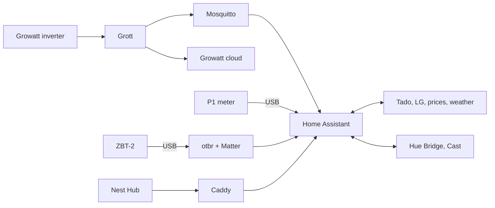

# Homelab

Home Assistant and its helpers on `home-pi` (Raspberry Pi 4, 2 GB, Debian 13), one Docker Compose stack in
`~/git/homelab`. LAN only; secrets in `.env` (not in git).

| | Address |
|---|---|
| Home Assistant | `http://192.168.2.26:8123`, HTTPS via the DuckDNS name ([HTTPS](https.md)) |
| These docs | `https://docs.<DuckDNS name>`, fallback `http://home-pi.local:8000` |
| OTBR web UI | `http://192.168.2.26:8083` |
| Growatt datalogger | `http://192.168.2.18` |
